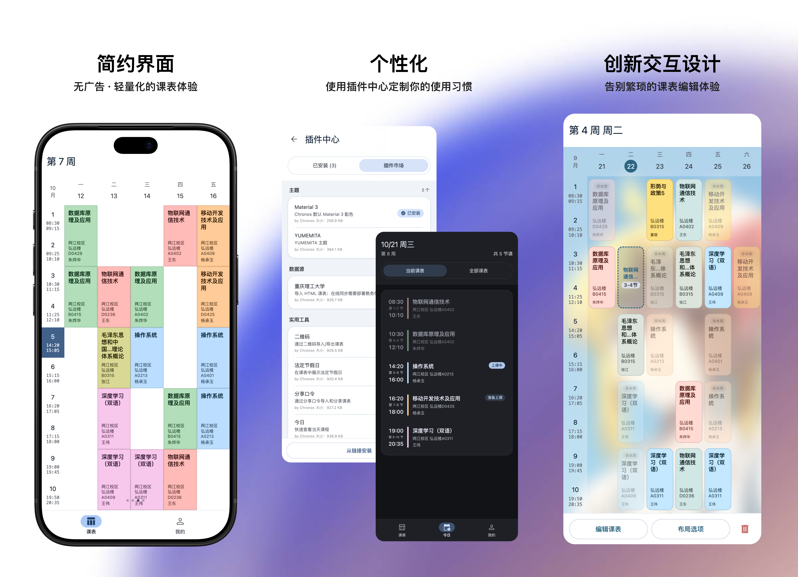

# Chronos

微内核、插件化的课程表应用框架

**[Ask DeepWiki](https://deepwiki.com/UE-DND/Chronos)**

## 基础功能

Chronos 的核心功能仅为查看、管理与分享课表。另外，您可在「插件中心」安装 Chronos 官方或第三方插件以个性化使用体验。

为了方便受限平台使用，Chronos 基于渐进式 Web 技术实现，能够在绝大多数浏览器或支持 WebView 技术的平台运行。本项目提供 Capacitor 客户端：Android 使用系统 WebView，并支持通知、小组件和应用内安装更新；iOS 使用 WKWebView，通过可自签的 IPA 分发，不能在应用内覆盖安装。

另外，受 [DeepSeek Harness](https://github.com/deepseek-ai/deepseek-harness) 启发，Chronos 允许外部能力以插件形式注入，并由内置的轻量运行时框架统一驱动。这一架构使得 Chronos 能够适应不同平台的发行，同时也为定制主题、工具以及不同学校的专用版本带来了极大便利。

> [!CAUTION]
> 从外部链接安装的插件，其代码在您的浏览器中与内置功能同等权限运行（非沙箱）。您需自行承担来源可信性及使用风险，我们不对第三方或外部来源插件的行为、数据处理或造成的损害承担责任。

> [!NOTE]
> 所有客户端目前仅适配了 Chromium 生态，在 Firefox、Safari(AppleWebKit) 上使用本项目可能受限。

## 导入课表

重庆理工大学定制 profile 支持以下与教务系统相关的导入方式：

#### 知行理工

在应用内选择导入方式为「知行理工」，按照提示输入学号 / 工号以及密码

#### 教务 HTML

在应用内选择导入方式为「教务 HTML」，并按照以下步骤操作：

1. 电脑端登录办事大厅
2. 进入【本科生教务管理系统 → 信息查询 → 个人课表查询】
3. 按下键盘的 `Ctrl + S` 或 `Cmd + S` 保存页面为 HTML 文件
4. 在 Chronos 中选择刚才保存的 HTML 文件即可

## 数据收集

官方托管的 PWA 应用与 GitHub Releases 中的 Android APK 会通过 Firebase Analytics 收集去标识化的使用情况以协助 Chronos 修复错误或改进使用体验。此选项可随时在应用内关闭。

详见应用内「关于 → 隐私政策」。

## 部署 Chronos ｜ 插件开发 ｜ 贡献代码

若发现问题，欢迎任何形式的贡献！无论是修复错误、改进功能，还是提升代码质量，我们都非常欢迎您的参与。

提交贡献前，推荐阅读 [CONTRIBUTING.md](CONTRIBUTING.md) 以了解建议的代码规范和提交流程。
