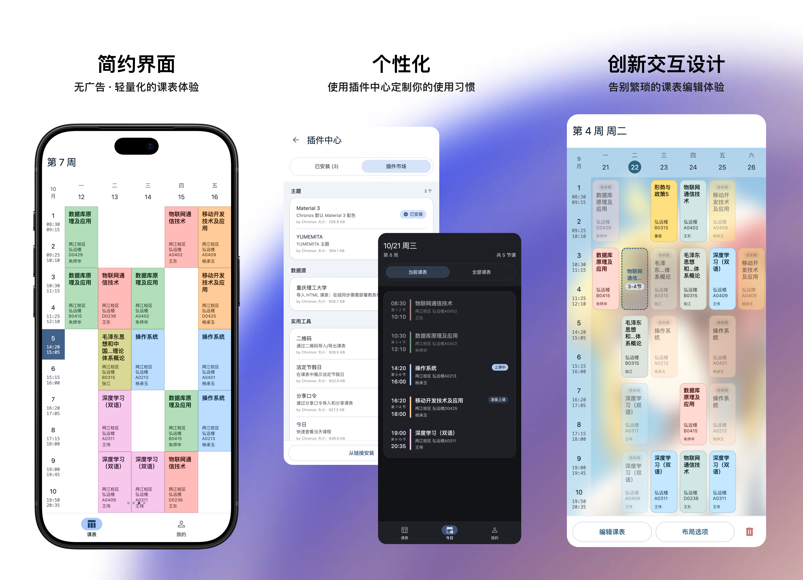

# Chronos

微内核、插件化的课程表应用框架

**[Ask DeepWiki](https://deepwiki.com/UE-DND/Chronos)**

## 基础功能

Chronos 用来查看、管理和分享课表。其余能力从「插件中心」安装，可以是官方插件，也可以是第三方插件。

应用基于渐进式 Web 技术，以便在浏览器和带 WebView 的环境里运行。本仓库提供 Capacitor 客户端：Android 使用系统 WebView，并支持通知、小组件和应用内更新；iOS 使用 WKWebView，以可自签的 IPA 分发，不能在应用内覆盖安装。

课表核心保持精简。主题、工具和学校数据源做成插件，由宿主在同一套运行时里加载。换一套发行配置，就可以改变预装插件和服务端能力，而不必为某个平台或某所学校分叉主程序。插件运行时的组织方式参考了 [DeepSeek Harness](https://github.com/deepseek-ai/deepseek-harness)。

> [!CAUTION]
> 从外部链接安装的插件，其代码在您的浏览器中与内置功能同等权限运行（非沙箱）。您需自行承担来源可信性及使用风险，我们不对第三方或外部来源插件的行为、数据处理或造成的损害承担责任。

> [!NOTE]
> 客户端目前主要适配 Chromium。在 Firefox 和 Safari（AppleWebKit）上使用时，功能可能不完整。

## 导入课表

重庆理工大学定制 profile 支持以下与教务系统相关的导入方式：

#### 知行理工

在应用内选择导入方式为「知行理工」，按照提示输入学号 / 工号以及密码

#### 教务 HTML

在应用内选择导入方式为「教务 HTML」，并按照以下步骤操作：

1. 电脑端登录办事大厅
2. 进入【本科生教务管理系统 → 信息查询 → 个人课表查询】
3. 按下键盘的 `Ctrl + S` 或 `Cmd + S` 保存页面为 HTML 文件
4. 在 Chronos 中选择刚才保存的 HTML 文件即可

## 数据收集

官方托管的 PWA 与 GitHub Releases 中的 Android APK 会通过 Firebase Analytics 收集去标识化的使用情况，用来排查问题和改进功能。这个选项可以随时在应用内关闭。

详见应用内「关于 → 隐私政策」。

## 部署、插件开发与贡献

发现问题或希望改进时，欢迎提交修复、功能和文档。提交前请先阅读 [CONTRIBUTING.md](CONTRIBUTING.md)。
